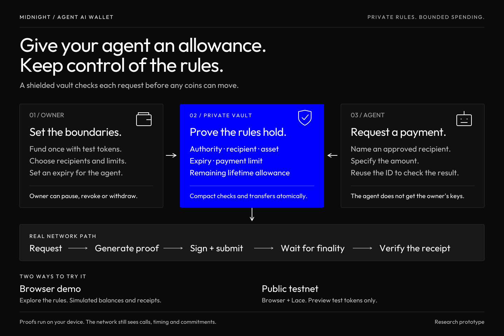
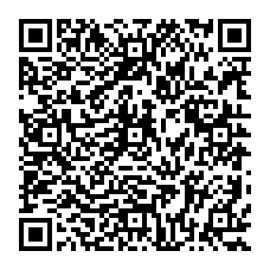

# Midnight Agent AI Wallet

[](LICENSE)

## About

An experimental AI agent vault on Midnight with private spending limits and owner recovery controls. Compact checks each payment's authority, recipient, asset, expiry and allowance before moving shielded funds.

[Open the demos](https://ibkr-bouncybot.github.io/Midnight-Agent-AI-Wallet/): explore a browser policy simulation, or try the real Preview flow with Lace and browser WASM proving. This is noncommercial research using test assets. A complete Lace-approved payment remains unverified; [the verification record](docs/verification.md) distinguishes proven components from completed network tests.



## Choose your demo

### [Open the app →](https://ibkr-bouncybot.github.io/Midnight-Agent-AI-Wallet/)

| Mode | What you can try | What you need |
| --- | --- | --- |
| [**Browser demo**](https://ibkr-bouncybot.github.io/Midnight-Agent-AI-Wallet/browser.html) | Set an allowance, request payments, inspect rejections, and try the owner controls. Balances and receipts are explicitly simulated. | A browser. No wallet, tokens or network transaction. |
| [**Public testnet demo**](https://ibkr-bouncybot.github.io/Midnight-Agent-AI-Wallet/testnet.html) | Generate contract proofs in your browser, approve wallet operations in Lace, and inspect actual Midnight **Preview** receipts. | A compatible browser, Lace with internal WASM proving, free Preview test NIGHT and usable DUST. |

Open the public-testnet page in the browser where Lace is installed. In Lace's Midnight settings select **On this device → Run in this app (WASM)**, then select Preview and confirm that setting on the page. Lace 2.5.0 includes this option; availability and memory capacity depend on your browser and device. You do not need Node, Docker or a separate proof server to use this flow.

Lace keeps its wallet keys and handles wallet approvals and fee proofs. The page proves the contract calls in a Web Worker and encrypts its private vault state in browser storage with a separate password. Save an encrypted backup: your Lace seed cannot recreate the contract's private openings. See [browser proving and setup](docs/browser-proving.md), including the limitation that Lace's API cannot independently confirm its proving mode.

Recipient preparation does not wait for chain-wide history replay. The app checks the received output in the exact finalized payment and verifies the vault's change separately. Its verified-received total records app receipts, not a spendable wallet balance. If you already started a session, **unlock the existing profile** with the same Lace account and storage password; keep its encrypted backup and stored recovery state.

**Earlier public Preview verification:** the local Node runner finalized a real vault payment in block **1627157**, with an independently synchronized merchant receipt and verified vault change. The [public transaction evidence](docs/evidence/preview-payment.json) records the actual 4,508-byte contract proof and matching ledger effects. This evidence belongs to that runner execution; it does not establish a completed browser-and-Lace payment.

**Browser verification:** actual WASM mint and payment-circuit proofs completed in a desktop browser (about 22 seconds and 3 minutes 22 seconds). Encrypted backup/restore and a partial Preview observer connection also passed. The user subsequently confirmed a Lace connection. A full Lace-approved payment and mobile compatibility remain unverified; the proof timings used synthetic fixtures. [Measured results](docs/verification.md).

The [local developer page](https://ibkr-bouncybot.github.io/Midnight-Agent-AI-Wallet/local.html) and [local runner setup](docs/testnet-demo.md) remain available as a separate fallback.

Read [the verification record](docs/verification.md) for measured results and remaining work. Browser simulation, native execution, proof generation, local settlement and public Preview settlement are separate checks. A working connection is not a settled payment.

## Included

- Compact private vault, test-token faucet and upstream environment smoke contract.
- Private policy/state commitments, separate owner/agent authority, pause/revoke, accounting-preserving policy replacement and owner withdrawal.
- Native tests for limits, privacy, replay and competing-state rejection.
- Local ledger/prover/indexer harness with independently observed recipient balances, private coin qualification and change recovery.
- Encrypted private snapshots, request journal and staged transaction runner; scoped provider-neutral payment schemas and an inspection-only MCP stdio endpoint.
- Current ChatGPT and Claude connection guidance, exact toolchain pins, CI and recovery documentation.
- Browser policy simulation, a browser/Lace Preview flow, and the previously verified local Preview runner.

The executable MCP endpoint is currently inspection-only. Authenticated remote MCP, Preprod validation and live ChatGPT/Claude payment tests remain development work. The app's agent request screen lets you exercise the payment boundary; it is not a connected AI model. No mainnet funds are used.

## Run

Node 24.18.0, Ubuntu 24.04/WSL2 and Docker are the tested environment. See [local setup](docs/local-setup.md) for installation, checksums and isolated network ports.

```sh
npm ci --ignore-scripts
# Linux: bash scripts/install-compiler.sh
# Windows: powershell -ExecutionPolicy Bypass -File scripts/install-compiler.ps1
npm run compile
npm test
node services/mcp/scripted-agent.mjs
```

Start the isolated network with `scripts/local-network.sh up`, then run:

```sh
node tests/network/upstream-smoke.mjs
node tests/network/private-vault.mjs
node tests/network/durable-vault.mjs
```

Generated keys go in `contracts/managed/`; local private state goes in `.local/`. Both are ignored. Never use the public development genesis seeds on a public network.

## Design and trust

One deployed vault currently supports one agent, one asset, four recipient slots and one lifetime deposit. Monetary values are decimal atomic units bounded to uint64. There are no currency conversion, recurring reset or top-up semantics. The owner chooses policy; the agent never receives owner wallet credentials.

The deployment flow disables the SDK-generated maintenance authority before funding and verifies the ledger result. Owner policy administration remains part of the immutable circuit rules. Any deployment path that omits the maintenance step retains a key able to replace those rules; it must not be advertised as immutable.

In the browser flow, contract witnesses are handled by the page's local WASM worker; Lace handles its own wallet proof inputs. A hosted prover would see private proof inputs, so the app rejects a reported external prover and requires the user to confirm Lace's internal setting. In the local developer flow, the runner and local prover see witnesses. Chain observers can see contract calls, timing, commitments, nullifiers, administrative flags and request validity windows. The model sees the payment it proposes. Recovery requires application-specific private openings as well as wallet material.

- [Contract and disclosure specification](docs/contract-design.md)
- [Browser proving, Lace and encrypted backups](docs/browser-proving.md)
- [Private recovery and durability](docs/recovery.md)
- [Runner transaction safety](docs/runner-transaction-safety.md)
- [Full handover acceptance status](docs/acceptance-status.md)
- [MCP boundary](services/mcp/README.md)
- [ChatGPT and Claude integration paths](docs/ai-connections.md)
- [Implementation plan](docs/implementation-plan.md)
- [Dependency review](docs/dependencies.md)

## Noncommercial license

You can study, modify and share the project for noncommercial purposes under [PolyForm Noncommercial 1.0.0](LICENSE), the same license used by Midnight Ballot Lab. Commercial use requires separate permission from the relevant rights holders. This applies to project-owned material; [third-party components retain their own licenses](THIRD_PARTY_NOTICES.md), including Ballot Lab assets, Midnight code and Outfit fonts.

The [published license and notices page](https://ibkr-bouncybot.github.io/Midnight-Agent-AI-Wallet/license.html) includes a downloadable copy of the exact terms.

## Buy me a coffee

If this wallet lab has been useful, you can support IBKR-BouncyBot with a little **NIGHT or ADA on Cardano mainnet**. Tips are optional; the demo is free to use.

Scan the QR code or copy the address below. The [front-page support section](https://ibkr-bouncybot.github.io/Midnight-Agent-AI-Wallet/#support) also has a copy button.



```text
addr1q85w2v474ywzx868s69pghygek3vrhxm69e7c6ysuf28qhv8kmj5wd059grxl82f8h5mtyzl87cvqj8ldv2e0las7tnsdej9ax
```

Thank you for supporting development.
